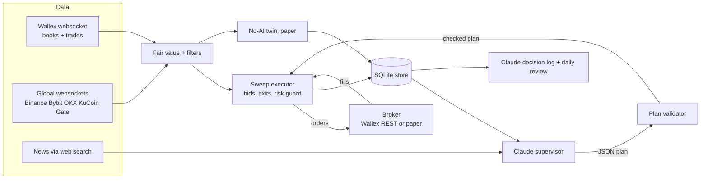
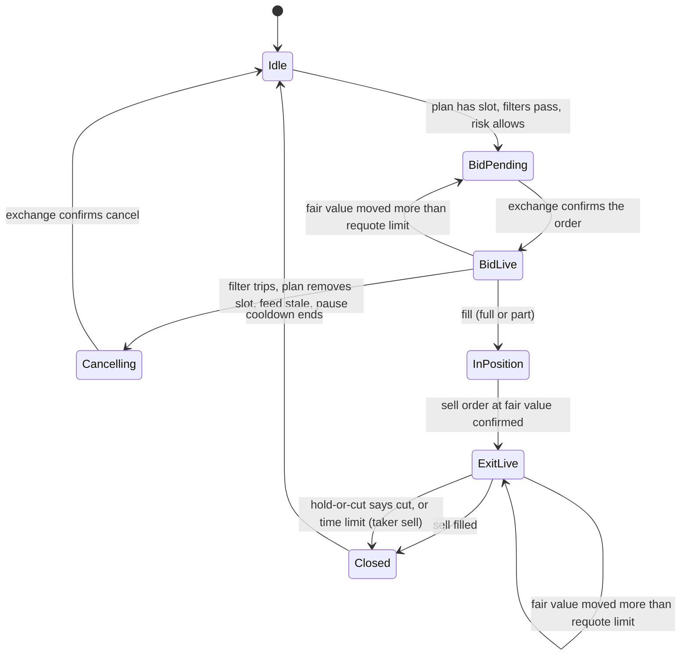

# Design: Wallex sweep bot

Status: milestone 1 (without the server runs) and milestone 3 (without the real-key call) are built. See `IMPLEMENTATION_PLAN.md` for the open tasks. The evidence for this design is in `RESEARCH.md` section 3. The task list is in `IMPLEMENTATION_PLAN.md`.

## 1. Goal

The bot keeps buy orders (bids) resting far below fair value on Wallex spot markets. A sweep fills a bid. The bot then sells at fair value. The bot must:

* end the challenge with a positive return in toman, and a small drawdown
* trade every day (activity and stability points)
* log every decision in readable form (a challenge rule)
* show a measurable effect of the AI part (AI points)
* run the same code in live, paper and replay mode (backtest, shadow test and reproducibility points)

Non-goals: short selling (margin is disabled), speed races against other takers, prediction of price direction.

## 2. Terms

| Term | Meaning |
|---|---|
| Fair value (FV) | Median best-quote mid of the global venues x USDTTMN mid (toman markets) x exp(premium). `lagcatcher.engine.Engine.fair_value` computes it. |
| Premium | Rolling 60-minute median of log(Wallex mid / raw fair value), sampled every 5 s, only from books with a spread of 0.3% or less. |
| Depth | Distance of our bid below fair value, in percent of fair value. The plan default is 1.3% on toman markets and 1.0% on USDT markets (team decision of 2026-10-22, from `RESEARCH.md` section 3.4). |
| Sweep | A market sell that trades through several levels of the book in a few milliseconds and leaves the price far below fair value for a short time. |
| Slot | One market that the plan allows a bid on. The number of slots is limited by the funds. |
| Plan | The JSON document that sets the slots, depths, sizes and pauses. Claude proposes it. The validator checks it. |
| Twin | A paper copy of the bot with a fixed plan and no AI. It runs on the same live data. |

## 3. Architecture



Rule: **the executor never waits for Claude.** A sweep lasts 0.01 to 3 s, and a model call takes 5 to 30 s. The executor works with the last valid plan. It also works with no plan at all (it then uses the default plan of the config). The runner starts each model job as a separate asyncio task. The supervisor runs the provider call in a worker thread with a timeout. Plan calls come at most once a minute, also during a burst of alerts.

## 4. Package layout

The sweep bot is a new package `sweepbot/` in this repo. It imports the parts of `lagcatcher` that already work and have tests. `lagcatcher` stays unchanged except for small refactors that the plan names.

| Module | Job | Reuses |
|---|---|---|
| `sweepbot/config.py` | Defaults and TOML loading for markets, depth, limits, model, mode | `lagcatcher.config` pattern |
| `sweepbot/market.py` | Live state: books, global quotes, fair value, premium | `lagcatcher.feeds`, `lagcatcher.fairvalue`, `lagcatcher.engine` (fair value parts) |
| `sweepbot/filters.py` | Global drop filter and FX shock filter | new |
| `sweepbot/slots.py` | Bid manager: one state machine per slot, requote rule, order budget | `lagcatcher.shadow.TokenBucket` |
| `sweepbot/exits.py` | Exit order at fair value, time limit, hold-or-cut request | new |
| `sweepbot/risk.py` | Hard limits, daily loss stop, equity floor, end-of-challenge flattening | new |
| `sweepbot/executor.py` | One executor tick: broker events, equity, plan, slot views, orders. Runs the bot and the twin. | new |
| `sweepbot/runner.py` | Wiring of all parts. Replay driver on raw files. Live loop: feeds, 100 ms ticks, premium, status, AI jobs, daily report. | `lagcatcher.feeds` |
| `sweepbot/broker.py` | `Broker` protocol, `PaperBroker` (lagcatcher fill rules), `WallexBroker` (REST) | `lagcatcher.shadow` fill rules |
| `sweepbot/wallex_broker.py` | `WallexBroker` on the Wallex REST API. Polls the open orders every second. | `docs/WALLEX_API.md` |
| `sweepbot/rules.py` | Price tick, quantity step and minimum value per market | `research/wallex_markets.json` |
| `sweepbot/endgame.py` | USDT sale at the end of the challenge | new |
| `sweepbot/store.py` | SQLite schema and writes | new |
| `sweepbot/ai/provider.py` | `ModelProvider` protocol, so that any model can fill the AI jobs. `FakeProvider` for tests. | new |
| `sweepbot/ai/claude.py` | Claude adapter (`anthropic` SDK, structured output, web search) | new |
| `sweepbot/ai/schema.py` | pydantic models: `Plan`, `HoldOrCut`, `TradeLog`, `Review` | new |
| `sweepbot/ai/validator.py` | Clamps a plan to the hard limits, rejects a bad plan | new |
| `sweepbot/ai/supervisor.py` | Builds the state snapshot, calls the provider, stores the result | new |
| `sweepbot/twin.py` | Runs a second executor with a fixed plan and a `PaperBroker` | new |
| `sweepbot/report.py` | Daily Markdown report from SQLite | `lagcatcher.report` table helpers |
| `sweepbot/__main__.py` | CLI: `run --mode live|paper`, `replay`, `report` | `lagcatcher.__main__` pattern |

## 5. Slot state machine

Each slot (one market in the plan) has one state.



Rules:

* **Bid price** = FV x (1 - depth / 100), rounded down to the price tick of the market.
* **Requote** only when the desired price differs from the live price by more than 0.2%. A deep bid does not need to follow every small move. This keeps the order budget low.
* **Order budget:** Wallex allows about 20 order requests per 10 s (to confirm, see the plan). The bot uses a token bucket of 15 per 10 s. Cancels for safety (filter, stale feed, pause) go first and can use the reserve of 5.
* **Part fill:** the exit sells the filled quantity. The rest of the bid is cancelled.
* **Exit price** = FV at the time of the fill, then requoted when FV moves more than 0.2%. This is the rule that the backtest used. Do not add a minimum profit to the exit without a new backtest.
* **Cooldown:** 60 s after a closed trade before the slot can bid again. 5 minutes after a loss.

### 5.1 Allocation over all markets

The bot watches all 18 markets. The funds allow only a few resting bids, and a bid must rest before a sweep comes. With `allocation.enabled`, `sweepbot/allocation.py` chooses the bid markets on every tick, when no AI plan exists (the twin always uses it):

1. A slot with coins, an exit order, or a bid that is being cancelled keeps its place.
2. The other places go to the eligible markets in the order of `allocation.ranking`: the market with more fills in the 60-day study at 1.0% comes first (RESEARCH.md section 3.7). So when two markets qualify for one place, the market with more fills gets it. A market is eligible when the Wallex and global feeds are fresh, it has a fair value, its spread is at most `filters.max_spread_pct`, no filter is on, USDT is bought (USDT markets), and it has no cooldown.
3. A bid younger than `allocation.switch_min_s` (60 s) keeps its place against a better market.
4. There are `allocation.tmn_slots` toman places and `allocation.usdt_slots` USDT places. An eligible market without a place gets a decision log row "qualifies, but no funds" (at most once per `allocation.log_every_s` per market).

The panel shows the used places, the markets without funds, and the markets that are not eligible with the reason.

## 6. Filters (fast path, no AI)

| Filter | Trips when | Action |
|---|---|---|
| Global drop | The global mid of the coin fell 0.3% or more in the last 60 s | Cancel the bids on all markets of that coin. Wait 120 s after the drop ends. |
| FX shock | The USDTTMN mid moved 0.5% or more in the last 5 minutes. During the nightly USDTTMN close, use the implied rate (median of coin TMN mid / coin USDT mid) instead. | Cancel all bids on toman markets. Wait 10 minutes. |
| Stale feed | No Wallex message for 5 s, or fewer than 2 fresh global venues for the coin | Cancel the bids of the affected markets. |
| Wide spread | The Wallex spread of the market is above 1.0% | No new bid on that market. The premium already ignores such books. |

The executor checks the filters on every book and quote update, and on a 100 ms timer.

## 7. Risk guard (hard limits)

The config sets these limits. No plan can change them. The validator clamps a plan to them, and the risk guard checks them again before each order.

| Limit | Value |
|---|---|
| Size of one bid | at most 1,000,000 toman (or its USDT value) |
| Open bids plus positions | at most 5 |
| Funds in USDT | at most 40% of equity, so that the two USDT markets of the default plan can both keep a bid of 1M (team decision of 2026-10-22) |
| Depth | between 1.0% and 2.5% |
| Time limit of a position | 15 minutes |
| Daily loss stop | -1.5% of the equity at the start of the day (Tehran time). Then cancel all bids until the next day. |
| Equity floor | -2.5% from the peak, or -4% from the start. Then cancel all bids and alert the team. |
| End of challenge | Stop new bids and sell all coins 2 h before the end, and at the latest 30 minutes before the USDT sale. Sell all USDT on USDTTMN from 30 minutes before the last USDTTMN close (23:30 Tehran, 20:00 UTC). `sweepbot/endgame.py` sends the USDT sale and replaces an order that stays open for 30 s. |

### 7.1 USDT purchase at the start

The challenge account starts with toman only. With `funding.usdt_target_share` above 0, `sweepbot/funding.py` buys USDT on USDTTMN for that part of the start equity before the first USDT-market bid. It counts the USDT that the account already holds, so a restart does not buy again. Until it is done, the executor sends no bid on a USDT market. `endgame.UsdtConverter` sells all USDT before the last USDTTMN close. The USDT holding carries currency risk. `config.live.toml` uses 40%.

## 8. AI part

### 8.1 Provider interface

```python
class ModelProvider(Protocol):
    def propose_plan(self, snapshot: StateSnapshot) -> Plan: ...
    def hold_or_cut(self, context: PositionContext) -> HoldOrCut: ...
    def write_trade_log(self, trade: TradeRecord) -> TradeLog: ...
    def daily_review(self, day: DaySummary) -> Review: ...
    def news(self) -> NewsSummary: ...
```

The news job runs at most once an hour (`ai.news_every_s`). It is a separate call with the web search tool. Its summary goes into the next supervisor snapshot. A "high" news risk starts a supervisor call. The other jobs use structured output and no tools.

`ClaudeProvider` is the first adapter. It uses the `anthropic` Python SDK, the model `claude-opus-5-5`, structured JSON output, and the web search tool for news. Another model (hosted or open weights) needs only a new adapter. Every provider call has a timeout of 60 s. On a timeout or an invalid answer, the supervisor keeps the last valid plan and logs the failure.

### 8.2 Jobs and timing

| Job | When | Input | Output |
|---|---|---|---|
| Supervisor | Every 15 minutes, and at once after an alert (filter trip, loss, feed problem) | State snapshot: equity, open orders, positions, last fills, filter state, spreads, sweep counts per market, USDTTMN state, time to the nightly close. News from web search. | `Plan` |
| Hold or cut | A position has no exit fill after 5 minutes | Position, FV path, global path, USDTTMN path, book, news summary | `HoldOrCut` |
| Trade log | After each closed trade, and after each plan change | Stored records | `TradeLog` text plus fields |
| Daily review | Once a day | Day summary of the bot and the twin | `Review`, with proposed changes inside the limits |

### 8.3 Plan schema

```json
{
  "valid_minutes": 30,
  "pause": false,
  "pause_reason": null,
  "slots": [
    {"market": "BTCTMN", "depth_pct": 1.3, "size_tmn": 1000000},
    {"market": "ETHUSDT", "depth_pct": 1.6, "size_tmn": 1000000}
  ],
  "fx_risk": "normal",
  "reasoning": "Short text for the decision log."
}
```

Validator rules: known markets only, no duplicate markets, depth in [1.0, 2.5], size up to the limit, number of slots up to the limit, USDT share up to the limit, `fx_risk` in {normal, high}. With `fx_risk = high`, the executor removes all toman-market slots. A plan older than `valid_minutes` falls back to the default plan of the config.

### 8.4 Twin

The twin runs the default plan (5 fixed markets, depth 1.3% on toman markets and 1.0% on USDT markets) with a `PaperBroker` on the same live data. The daily report compares the bot and the twin. This shows the effect of the AI part in numbers.

## 9. Broker

```python
class Broker(Protocol):
    async def place_limit(self, market: str, side: str, price: float, qty: float) -> str: ...
    async def cancel(self, order_id: str) -> None: ...
    async def open_orders(self) -> list[Order]: ...
    async def balances(self) -> dict[str, float]: ...
```

* `PaperBroker` fills orders with the lagcatcher rules: a bid fills only when a seller trades strictly below it or the best ask falls to it, and a sell fills when a buyer trades strictly above it or the best bid rises to it.
* `WallexBroker` uses the Wallex REST API with the account API key from an environment variable. The order endpoints, the auth header, the price ticks and the rate limits must come from the Wallex API documentation (task in the plan). Do not guess them.
* At start, the live broker reads the open orders and balances, and cancels unknown orders of the bot's markets.
* The private websocket of Wallex needs a browser login cookie. So `WallexBroker` polls `GET /v1/account/openOrders` every second, and reads a finished order by its client id. A fill can come up to 1 s late.
* The bot sets its own `client_id` for each order. After a lost answer, it reads the order by this id before a retry, so a retry cannot place the same order twice.

## 10. Storage

SQLite file `data/sweepbot.db`, one writer (the bot process).

| Table | Rows |
|---|---|
| `orders` | id, ts, market, side, price, qty, status, reason, plan_id, mode (live, paper, twin) |
| `fills` | order_id, ts, price, qty, fee, maker |
| `trades` | entry and exit fill ids, net toman, net %, hold seconds, exit reason |
| `plans` | id, ts, provider, model, raw JSON, validated JSON, accepted |
| `ai_calls` | ts, job, model, input tokens, output tokens, cost, latency, error |
| `filter_events` | ts, filter, market or coin, start or end |
| `logs` | ts, kind (trade, plan, review), text, fields JSON |

The raw market data stays in the lagcatcher gzip JSONL files, so a replay can run on the same hours.

## 11. Modes

| Mode | Market data | Broker | Purpose |
|---|---|---|---|
| `replay` | lagcatcher raw files | `PaperBroker` | Backtest on recorded order books. Claude calls are off or recorded. |
| `paper` | live | `PaperBroker` | Shadow test before the challenge |
| `live` | live | `WallexBroker`, plus the twin on `PaperBroker` | The challenge |

## 12. Failure handling

| Failure | Action |
|---|---|
| Wallex websocket stale | Cancel all bids. Reconnect (lagcatcher feed logic). |
| Global feeds stale for a coin | Cancel the bids of that coin. |
| REST error on place | Retry once after 1 s. Then mark the slot idle and log it. |
| REST error on cancel | Retry until confirmed. Block new bids on that market until then. |
| Model timeout or invalid output | Keep the last valid plan. After 2 failures in a row, use the default plan. |
| Process restart | Read open orders and balances from the exchange. Rebuild positions from SQLite. Cancel unknown orders. |
| Disk below 400 MB | Stop raw recording (lagcatcher guard). Below 250 MB, cancel all bids and stop. |

## 13. Tests

* Unit tests for each module with the given/when/then style of `tests/`.
* Filter tests with the real events: the 2026-10-01 05:36 USDTTMN crash must trip the FX filter, and a Binance drop of 0.3% must cancel the bids.
* Replay test: the 07:03 BTCTMN sweep in the raw files must give one fill and one exit at fair value with the default plan.
* Validator tests: every limit in section 7 has a test with a plan that breaks it.
* Paper parity: a 24 h paper run must give the same fills as a replay of the same hours.

## 14. Stack

| Part | Choice |
|---|---|
| Language | Python 3.10+, asyncio, uv |
| Market data | `websockets` (lagcatcher feeds) |
| Exchange REST | `httpx` (async) |
| AI | `anthropic` SDK, `claude-opus-5-5`, structured output, web search tool. Other models through `ModelProvider`. |
| Schemas | `pydantic` |
| Storage | SQLite (`sqlite3` from the standard library) plus gzip JSONL raw files |
| Tests | `pytest` |
| Run | systemd unit on a Linux server with CPU and memory limits |
| Reports | Markdown and HTML generated from SQLite, kept in the repo |

Cost estimate of the AI part for the 3-day challenge: about 290 supervisor calls and about 100 other calls, $35 to $45 with `claude-opus-5-5`.

## 15. Panel

A web panel shows the live bot and lets a person pause it or sell all coins. Start it next to the bot: `python -m sweepbot panel`, then open http://127.0.0.1:8765.

| Part | Job |
|---|---|
| Bot (`Runner.write_state`) | Writes `<out_dir>/state.json` every second: slots, equity, filters, feeds, plan, endgame times, the wallet (every asset with its toman value, read from the broker every `bot.balances_every_s`) and the state of the USDT purchase. |
| Bot (`Runner.apply_control`) | Reads `<out_dir>/control.json` every second and applies it. |
| `sweepbot/panel.py` | Separate process, standard library only. Serves the page, `GET /api/state` (state file plus today's trades, the decision log and the AI cost from SQLite) and `POST /api/control`. |
| `sweepbot/panel_static/index.html` | The page. It reads `/api/state` every 2 s. Times show in Tehran time. |

Controls:

* **Pause new bids**: no new bids, the live bids are cancelled. Open positions keep their exits.
* **Stop and sell all coins**: also sells all positions at once with taker orders (exit reason `flatten`). The USDT stays. The USDT sale runs on its own schedule.
* Each change goes into the decision log (kind `control`). The control file stays after a restart, so a restarted bot keeps the last controls.

Safety:

* The panel listens on 127.0.0.1 only. On the server, open it through an SSH tunnel: `ssh -L 8765:127.0.0.1:8765 root@server`. The controls have no login, so never bind it to a public address.
* `POST /api/control` needs `Content-Type: application/json`, so a form on another website cannot send it.
* A panel crash does not stop the bot. A stopped bot shows as a red banner ("No fresh data") after 10 s.

